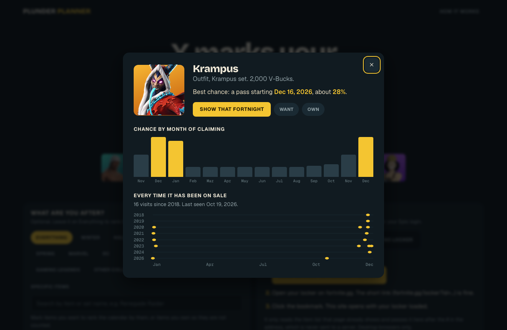

# Plunder Planner

**A Pirate Shop Access optimiser for Fortnite.** Paste your fortnite.gg locker and see which 14 days of free
Item Shop access would unlock the most cosmetics you do not already own.

**Live site: https://muhammadmurtuzahussain.github.io/plunder-planner/**


## What it does

- **Three ways to say what you own, none of which need your Epic login.**
  - *One-click import:* drag a button to your bookmarks bar, open your fortnite.gg locker (the short
    `locker?id=` link works) and click it. It reads the item list that page already shows and hands it to
    this site after the `#` in the address, which never reaches a server.
  - *Paste a link:* a long `my-locker?items=` link, or a plain list of fortnite.gg item ids.
  - *No locker:* tick the groups you own most of (Marvel, winter, Chapter 1 originals and so on) and add
    single items with the search.
- **Nothing leaves your browser.** No account, no server, no tracking, no AI model.
- **One clear answer.** "Claim it on Dec 15", the reasons, and the item art you are likely to get, for the 2026
  pass (which must be claimed by Dec 15, 2026) and the 2027 one.
- **A year you can drag across.** The whole calendar as one strip, brighter where a start date is better. The
  list of likely items changes as you move.
- **"When is it coming back?" for any item.** Click an item for every past shop visit and its chance month
  by month. Add it to a wishlist to see its curve across the year.
- **Things to take away.** A share image of your plan and a calendar reminder for the claim date, both made
  in the browser.
- **The receipts.** Last year's forecast, made only from earlier data, drawn against what the shop really sold.
- **Shows what you would likely get.** For any fortnight, the items most likely to be on sale that are new to
  you, each with its chance, plus the items you own that are likely to take up shelf space.
- **Claim or wait.** A daily call that compares the live shop with the last year of days for your locker, with a
  countdown to the 2026 claim deadline.
- **Helps players still hunting for a token.** Treasure Hour countdown, the announced schedule in your
  timezone, and a calculator for your chance of a drop before the hunt ends.
- **Collabs or originals.** Count only licensed crossovers, or only Fortnite's own designs, if that is what you
  care about.
- **Lets you chase what you want.** Pick a season, a collab family, or search for specific items, and the
  calendar is re-ranked by the ones you are missing.

### A note on locker bots

Discord bots that produce a `my-locker?items=` link do it by linking to your Epic account. That gives a third
party access to the account, and there are reports of scams and of V-Bucks being spent. Plunder Planner never
asks for an Epic login, and the import button and the no-locker mode avoid those bots entirely.

### Still hunting


### Chasing a season


### Item pages



## Shareable links

| Link | Opens |
|---|---|
| `?start=empty` | The plan for an empty locker |
| `?start=empty&mode=hunt` | The token-hunt view |
| `?start=empty&source=collab` | Only collab items counted (also `original`) |
| `?item=Krampus` | That item's page: past visits and chance by month |
| `?start=empty&want=winter` | The calendar ranked by winter items (also `halloween`, `summer`, `valentine`, `spring`) |

## How the estimate works

A pass is worth the shop total for those 14 days minus the part you already own. The two halves are
estimated separately.

- **Shop total.** Close to flat through the year, so it uses last year's average with a cautious seasonal
  nudge from the two previous years.
- **Owned part.** A logistic regression gives each of 8,413 shop items a chance of being on sale in a given
  fortnight, from how often it returns, how long it has been away, and whether its past visits cluster
  around these dates. Those chances are summed over your locker.

### How far to trust it

Tested by hiding a year of data and forecasting it (`npm run backtest`):

| Check | Result |
|---|---|
| Item chances, when the model said 13% | items turned up 12% of the time |
| Item chances, when the model said 34% | items turned up 33% of the time |
| Expected fortnight value, latest test year | off by about 9% on average |
| Expected fortnight value, the year before | off by about 24% (the shop itself grew that year) |
| Picking the single best fortnight a year ahead | barely better than chance |

The last row is the honest limit: roughly a quarter of any fortnight's value comes from items that did not
exist a year earlier. Seasonal rankings are steadier, because festive items return on a reliable schedule.

## Run it locally

```bash
npm install
npm run dev
```

## Project layout

| Path | Purpose |
|---|---|
| `scripts/build_dataset.py` | Joins the two data sources into `public/data/catalog.json` |
| `scripts/train.ts` | Fits the logistic regression weights in `src/lib/coefficients.json` |
| `scripts/backtest.ts` | Hides a year of data and scores the forecast against what happened |
| `src/lib/locker.ts` | Decodes locker links and id lists, and builds the import bookmarklet |
| `src/lib/model.ts` | Per-item chances, shop baseline and window scoring |
| `src/lib/hunt.ts` | Drop odds and Treasure Hour maths, fed by `hunt-data.json` |
| `scripts/update_hunt.ts` | Daily refresh of `hunt-data.json` from fortnite.bot |
| `src/components/` | The interface |

## Refreshing the data

```bash
curl -o data/raw/cosmetics_all.json "https://fortnite-api.com/v2/cosmetics?responseFlags=7"
npm run data
node scripts/train.ts
```

fortnite.gg blocks scripted downloads, so `data/raw/fngg/all.en.js` has to be saved from a normal browser
session at `https://fortnite.gg/data/items/all.en.js`. Drop odds, Treasure Hour times and boosts live in `src/lib/hunt-data.json`. A daily GitHub Action runs
`scripts/update_hunt.ts`, which reads them from fortnite.bot/treasure, commits any change and redeploys the
site. Hours the source only expects (not yet confirmed by Epic) are labelled as such. If the source's page
layout changes, the script fails on purpose and GitHub emails the repository owner.

## Credits

Built by [Muhammad Murtuza Hussain](https://github.com/MuhammadMurtuzaHussain).

- Shop history: [fortnite-api.com](https://fortnite-api.com)
- Prices and locker link format: [fortnite.gg](https://fortnite.gg)
- Drop odds and Treasure Hour times: [fortnite.bot](https://fortnite.bot/treasure)

Code is MIT licensed. The bundled item data belongs to its sources. Not affiliated with or endorsed by Epic Games.
