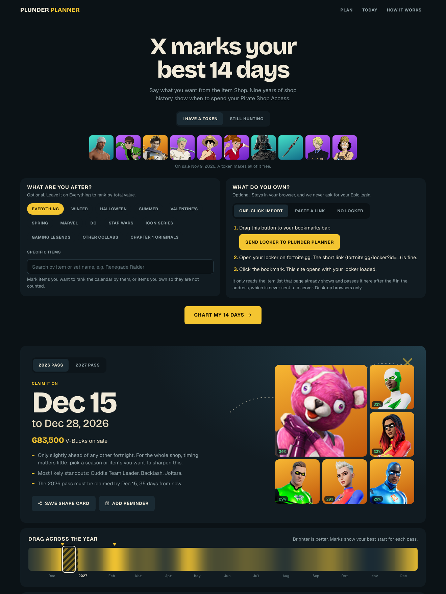
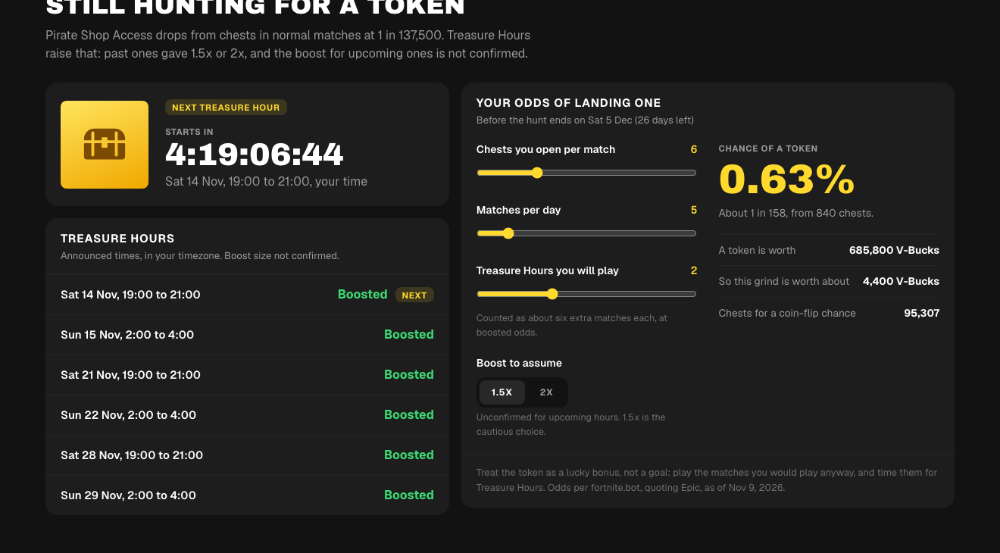
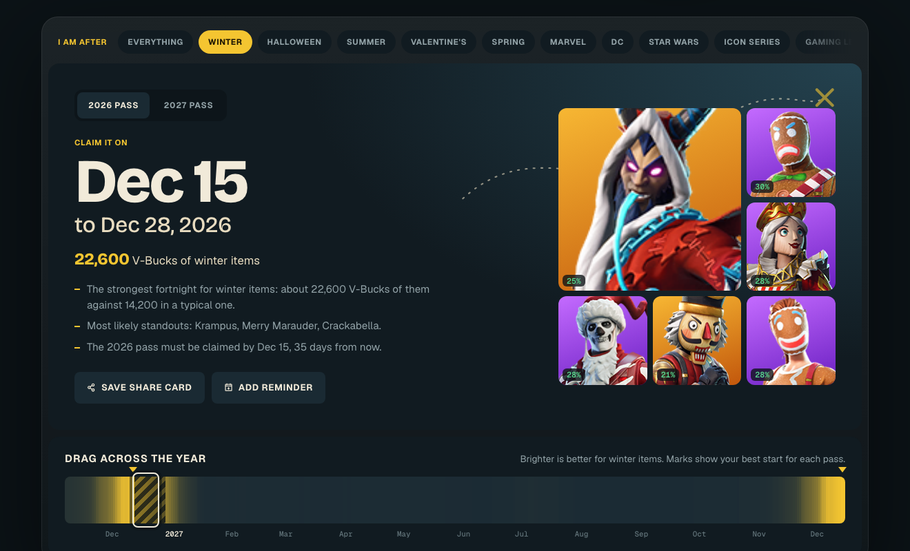

# Plunder Planner

**A Pirate Shop Access optimiser for Fortnite.** Paste your fortnite.gg locker and see which 14 days of free
Item Shop access would unlock the most cosmetics you do not already own.

**Live site: https://muhammadmurtuzahussain.github.io/plunder-planner/**



## What it does

- **Reads your locker privately.** A fortnite.gg "Copy link" URL contains the whole locker in compressed form.
  It is unpacked in your browser. No account, no server, no tracking, no AI model.
- **Ranks every 14-day pass through 2027.** Each start date gets an expected value: everything the shop should
  sell in those 14 days, minus what you already own. You get one pick for the 2026 pass and one for 2027.
- **Shows what you would likely get.** For any fortnight, the items most likely to be on sale that are new to
  you, each with its chance, plus the items you own that are likely to take up shelf space.
- **Answers "should I start today?"** Compares the live shop with the last year of days for your locker.
- **Helps players still hunting for a token.** Treasure Hour countdown, the announced schedule in your
  timezone, and a calculator for your chance of a drop before the hunt ends.
- **Lets you chase a season.** Pick winter, Halloween, summer, Valentine's or spring and the calendar is
  re-ranked by the seasonal items you are missing.

### Still hunting



### Seasonal picker



## Shareable links

| Link | Opens |
|---|---|
| `?start=empty` | The plan for an empty locker |
| `?start=empty&mode=hunt` | The token-hunt view |
| `?start=empty&want=winter` | The calendar ranked by winter items (also `halloween`, `summer`, `valentine`, `spring`) |

## How the estimate works

A pass is worth the shop total for those 14 days minus the part you already own. The two halves are
estimated separately.

- **Shop total.** Close to flat through the year, so it uses last year's average with a cautious seasonal
  nudge from the two previous years.
- **Owned part.** A logistic regression gives each of 8,413 shop items a chance of being on sale in a given
  fortnight, from how often it returns, how long it has been away, and whether its past visits cluster
  around these dates. Those chances are summed over your locker.

### How far to trust it

Tested by hiding a year of data and forecasting it (`npm run backtest`):

| Check | Result |
|---|---|
| Item chances, when the model said 13% | items turned up 12% of the time |
| Item chances, when the model said 34% | items turned up 33% of the time |
| Expected fortnight value, latest test year | off by about 9% on average |
| Expected fortnight value, the year before | off by about 24% (the shop itself grew that year) |
| Picking the single best fortnight a year ahead | barely better than chance |

The last row is the honest limit: roughly a quarter of any fortnight's value comes from items that did not
exist a year earlier. Seasonal rankings are steadier, because festive items return on a reliable schedule.

## Run it locally

```bash
npm install
npm run dev
```

## Project layout

| Path | Purpose |
|---|---|
| `scripts/build_dataset.py` | Joins the two data sources into `public/data/catalog.json` |
| `scripts/train.ts` | Fits the logistic regression weights in `src/lib/coefficients.json` |
| `scripts/backtest.ts` | Hides a year of data and scores the forecast against what happened |
| `src/lib/locker.ts` | Decodes a locker link (base64url, raw deflate, delta-encoded ids) |
| `src/lib/model.ts` | Per-item chances, shop baseline and window scoring |
| `src/lib/hunt.ts` | Drop odds and Treasure Hour times |
| `src/components/` | The interface |

## Refreshing the data

```bash
curl -o data/raw/cosmetics_all.json "https://fortnite-api.com/v2/cosmetics?responseFlags=7"
npm run data
node scripts/train.ts
```

fortnite.gg blocks scripted downloads, so `data/raw/fngg/all.en.js` has to be saved from a normal browser
session at `https://fortnite.gg/data/items/all.en.js`. The drop odds and Treasure Hour times in
`src/lib/hunt.ts` are constants and need a manual edit if Epic changes them. The Treasure Hour boost for
upcoming hours is unconfirmed (past ones were 1.5x or 2x), so the calculator lets you choose.

## Credits

Built by [Muhammad Murtuza Hussain](https://github.com/MuhammadMurtuzaHussain).

- Shop history: [fortnite-api.com](https://fortnite-api.com)
- Prices and locker link format: [fortnite.gg](https://fortnite.gg)
- Drop odds and Treasure Hour times: [fortnite.bot](https://fortnite.bot/treasure)

Code is MIT licensed. The bundled item data belongs to its sources. Not affiliated with or endorsed by Epic Games.
